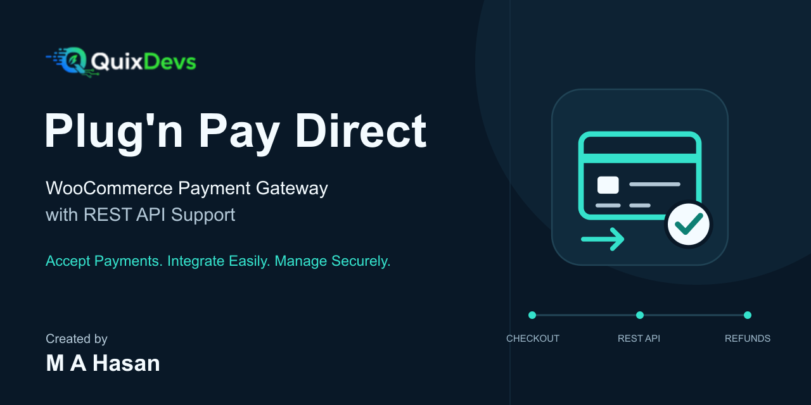
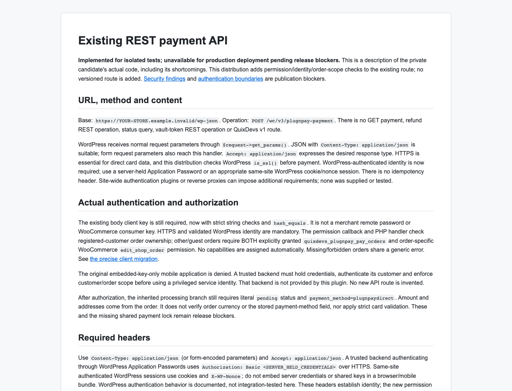

# QuixDevs Plug'n Pay Direct

A free, open-source Plug'n Pay payment gateway integration for WordPress and WooCommerce.

[](CHANGELOG.md)
[](LICENSE)
[](docs/testing.md)
[](docs/testing.md)



## 📥 Download & Installation

### Download Latest Stable Release

**[⬇️ Download QuixDevs Plug'n Pay Direct v1.0.0](https://github.com/hasancse06/QuixDevs-Plug-n-Pay-Direct-WooCommerce-Payment-Gateway/releases/download/v1.0.0/quixdevs-plugnpay-direct.zip)**

[View All Releases](https://github.com/hasancse06/QuixDevs-Plug-n-Pay-Direct-WooCommerce-Payment-Gateway/releases)

### Installation

1. Download the plugin ZIP using the link above.
2. Navigate to **WordPress → Plugins → Add New → Upload Plugin**.
3. Upload `quixdevs-plugnpay-direct.zip`.
4. Click **Install Now**, then activate the plugin.
5. Navigate to **WooCommerce → Settings → Payments**.
6. Configure your Plug'n Pay merchant account.

Activate only one gateway copy at a time. Existing installations using the historical plugin basename should follow the [installation and replacement guide](docs/installation.md) and [version history](docs/version-history.md).


## Features

| Feature | Implemented functionality |
|---|---|
| Plug'n Pay integration | Direct HTTPS processing through the existing Plug'n Pay remote gateway, using trusted KYD order amounts |
| WooCommerce checkout | Classic Checkout card form and existing merchant settings; gateway ID `plugnpaydirect` |
| Payment transactions | Verified processor approval and a valid transaction reference required before completing an order |
| Refunds | Full or partial refunds through the existing Return operation, limited to one provider Return per original transaction |
| Duplicate-charge safeguards | Durable shared payment/refund attempt records prevent overlapping and replayed submissions |
| Order reconciliation | Authorized WP-CLI review/reconciliation after the merchant checks processor records; uncertain attempts are not automatically retried |
| REST integration | Retained payment endpoint with authenticated identity and order authorization |
| HPOS order storage | Core payment, refund, reference lookup and reconciliation paths tested with legacy and HPOS storage |
| Sensitive-data safeguards | Typed validation, encoded requests, verified TLS, filtered provider output and restricted diagnostics |
| Saved methods | Customer-owned saved methods use their own verified previous-transaction reference |

Checkout Blocks is not implemented. Full optional Subscriptions/Pre-Orders compatibility is not certified. Legacy saved methods without a verified reference require fresh card entry and re-saving. See [refund behavior](docs/refunds.md), [reconciliation](docs/reconciliation.md) and the [compatibility matrix](docs/compatibility.md).

## Requirements & Compatibility

| Component | Requirement | Recorded verification |
|---|---|---|
| WordPress | 6.2+ declared in plugin metadata | 6.9 |
| WooCommerce | Required; no numeric minimum is declared | 10.9.0 |
| PHP | 8.2+ | 8.2.4 and 8.4.13 |
| Order storage | Standard WooCommerce legacy or HPOS storage | Core paths tested in both modes |
| Currency | KYD | Trusted positive KYD order totals |
| Transport/account | HTTPS and a configured Plug'n Pay merchant account | Processor responses mocked during automated tests |

WordPress 6.2 is the declared minimum, rather than a separately tested combination. Configured CI versions are not additional compatibility claims. The shared journal and reconciliation locks assume one authoritative primary database with connection affinity. [Executed test matrix and limits](docs/testing.md).

## Merchant Configuration

Open **WooCommerce > Settings > Payments > QuixDevs Plug'n Pay Direct**. Configure the publisher name/email, client key, remote client password, accepted cards and saved-card preference, then enable the gateway. Existing stores retain the gateway and merchant-setting identifiers.

Set `QUIXDEVS_PLUGNPAY_VERIFICATION_KEY` through administrator-controlled server configuration before plugins load. There is no embedded fallback key. Keep merchant credentials and authentication secrets out of source control, screenshots, logs and browser/mobile bundles. Verify HTTPS detection when the store uses a reverse proxy.

Configure the merchant account, credentials and verification hash for the intended Plug'n Pay account, then validate checkout, declines, refunds and reconciliation with the processor before handling production transactions. [Configuration guide](docs/configuration.md).

## REST API

The retained payment operation is:

```text
POST /wp-json/wc/v3/plugnpay-payment
```

The distributed version requires **HTTPS, a WordPress-authenticated identity, the existing client-key field and authorization for the order**. Customers may pay their own orders; a trusted backend handling guest/other orders needs explicit payment and order-edit permissions. The plugin does not automatically grant those permissions.

Existing applications that authenticated only with an embedded client key require migration. Supported authentication uses a same-site WordPress session with REST nonce, or a trusted backend holding an Application Password. A direct browser request exposes the required body key to that browser; keeping it strictly server-side requires an application-owned authenticated bridge. Clients must handle the documented errors and safe output, and must not automatically retry an uncertain payment.

See the [REST API reference](docs/rest-api.md), [authentication and migration guide](docs/api-authentication.md) and [old/current client comparison](docs/rest-client-comparison.md).

## Security & Processor Validation

This is a **direct-card gateway**: payment data passes through the merchant's server to Plug'n Pay. Merchants remain responsible for their applicable **PCI DSS obligations**. No PCI certification or SAQ eligibility is claimed.

- Use HTTPS and protect merchant credentials in server-controlled configuration.
- Do not store or log full card numbers, card security codes, authentication secrets or raw processor responses.
- For a timeout or uncertain result, check the processor record and follow the [reconciliation procedure](docs/reconciliation.md) before any further action.
- Validate behavior for the actual merchant account before production use. Automated mocked responses do not confirm live processor authorization or settlement.

Read the [security guide](docs/security.md). Report sensitive issues through [SECURITY.md](SECURITY.md), without sending payment or credential data.

## Documentation & Preview

[Installation](docs/installation.md) · [Configuration](docs/configuration.md) · [REST API](docs/rest-api.md) · [Refunds](docs/refunds.md) · [Reconciliation](docs/reconciliation.md) · [Troubleshooting](docs/troubleshooting.md)

[Changelog](CHANGELOG.md) · [Test reports](docs/testing.md) · [Architecture](docs/architecture.md) · [Payment protocol](docs/payment-flow.md) · [Release readiness](docs/github-release-readiness.md) · [Maintainer release process](docs/release-distribution.md)



*Actual local rendering of the documentation, not a WordPress admin screenshot. QuixDevs branding and editable artwork are included in the repository, outside the installation ZIP.*

## License & Attribution

**License: GPL-2.0-or-later.** See the complete [GNU GPL v2 license](LICENSE) for version 2 or any later version. Copyright (c) 2026 Md Abu Hasan / QuixDevs for developer-owned code.

Historical PatSaTECH attribution and applicable third-party notices are preserved in [UPSTREAM-NOTICES.md](UPSTREAM-NOTICES.md) and [THIRD-PARTY-NOTICES.md](THIRD-PARTY-NOTICES.md). See the [licensing review](docs/licensing-review.md) for their scope. The plugin is independent; no official endorsement by Plug'n Pay or WooCommerce is claimed.

## Author & Developer

**Author and maintainer: [QuixDevs](https://quixdevs.com/)**

Developed by **Md Abu Hasan**.

- Portfolio: [hasan.online](https://hasan.online/)
- GitHub: [hasancse06](https://github.com/hasancse06)
